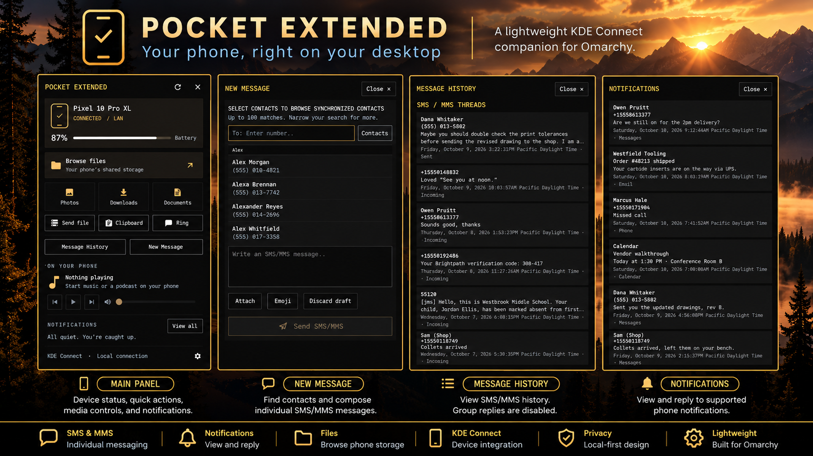

# Pocket Extended

Pocket Extended is an Omarchy bar plugin that presents KDE Connect device controls, Android notifications, SMS/MMS history and composition, and event-only call notices. It is separate from the original Pocket.

**Prepared version:** `1.0.0-rc.1` (release candidate; not a final release).



## What it does

- Shows selected-device status, file browsing, clipboard, ring-phone and media controls.
- Shows active Android notifications and provides Reply or Dismiss when KDE Connect exposes those actions.
- Composes individual SMS/MMS messages and replies to reliably classified individual conversations. Group and incomplete-scope replies remain disabled; group history remains visible.
- Shows synchronized contacts, bounded conversation history and explicitly retrieved MMS attachments.
- Presents incoming and missed call events without call controls.

Notification replies, SMS/MMS, attachments and calls use separate action paths. A notification icon is not message media. Pocket Extended does not provide RCS, complete phone history, arbitrary media from third-party notification apps, or call answer/reject controls.

## Requirements and tested environment

Runtime requirements for the tested setup are Omarchy with Quickshell, Qt 6 and Omarchy's `qs.Commons`/`qs.Ui` QML modules, Python 3 with PyGObject/Gio and GLib, and KDE Connect desktop. Android phone features require KDE Connect for Android, pairing, network reachability, the relevant KDE Connect plugins and Android permissions.

The independently reviewed host environment was Omarchy `4.0.4-1`, Quickshell `0.3.1-1`, Qt base `6.11.2-3`, KDE Connect desktop `26.08.0-1`, and PyGObject `3.56.3-1`. These are the versions tested, not minimum supported versions. Android/KDE Connect app compatibility beyond the controlled test setup is not established. Other distributions, versions and devices have not been validated as a matrix; iPhone support is untested.

File integration is optional. Sending files and selecting SMS/MMS attachments requires Omarchy's `omarchy-file-select`; plain SMS and notifications do not. Browsing files on the phone additionally requires host `sshfs`, `kio-fuse`, Nautilus and compatible KDE Connect file-browsing setup. Plugin installation does not install packages, pair devices or grant permissions.

## Pairing and permissions

Install KDE Connect desktop and the Android app from the [official KDE Connect download page](https://kdeconnect.kde.org/download.html). Open both apps on devices that can reach one another on the same network, request pairing from either device, and accept the request on the other. Then enable the KDE Connect SMS and Notification Sync plugins as needed. Grant SMS and Contacts permissions for messaging/contact names, and grant Android notification access for forwarded notifications. Android screens vary by version; see [KDE UserBase pairing](https://userbase.kde.org/KDEConnect/en#Pairing_two_devices_together) and KDE's [Android permission explanations](https://community.kde.org/KDEConnect/PrivacyPolicy#Android_permissions). Files browsing is optional.

## Installation

After a public release is approved, install using Omarchy's plugin manager. This command adds the repository's current default branch and does not pin an exact version:

```sh
omarchy plugin add https://github.com/oidium/omarchy-pocket-extended.git
```

Review the installed commit against the approved release, validate, then enable it. In the interactive add flow, decline the enable prompt until that review is complete. Fresh install, same-lineage update and migration from manual/private installations have different requirements; follow [Operations](docs/OPERATIONS.md). This unpublished candidate is not an installation target.

## Service and data lifecycle

Omarchy keeps one plugin Service and one messaging worker alive while the popup is closed. Each monitor has its own panel and drafts. Small bounded draft snapshots live in Service memory so a panel recreated on the same output can restore its text. A full Service/plugin unload or shell restart loses in-memory drafts. Pending sends and file pickers are not replayed.

Message history and notification views are bounded working data, not a mirrored phone database. The worker retains at most 200 threads, 300 messages per thread, 2,000 messages total, and 32 MiB of normalized messages. Individual complete message events are limited to 600 KiB. The worker retains up to 128 notifications. Disconnects and restarts can clear live data; refresh asks KDE Connect for available state.

Pocket Extended persists only bounded local notification-removal state under `${XDG_STATE_HOME:-~/.local/state}/omarchy-pocket-extended/notification-removals-v1.json`. This is a local Pocket suppression/occurrence record. Removing a notification from Pocket does not dismiss it on the phone. The file is owner-checked and bounded. Back it up before replacing or removing the plugin if you want to preserve local suppression state; uninstall does not clear it or KDE Connect's own caches.

See [Architecture](docs/ARCHITECTURE.md) for state ownership and failure behavior, and [Operations](docs/OPERATIONS.md) for pairing, update, migration, backup, rollback and removal guidance.

## Privacy and limits

The runtime has no telemetry upload or background diagnostics collection. Message, notification and contact data travels through the user's KDE Connect session and plugin IPC, and relevant working state remains in bounded memory. KDE Connect separately owns its device-side synchronization and MMS cache.

Successful submission to KDE Connect does not establish carrier delivery or recipient receipt. Incoming history may be partial, and an outgoing message can be absent from KDE Connect desktop History even when visible on the phone. Pocket Extended does not fabricate a history entry from submission success.

Individual conversation replies use KDE Connect's `replyToConversation`. KDE Connect selects recipients from its cached conversation and does not expose an atomic recipient snapshot to Pocket Extended. Pocket validates the observed recipient scope and fails closed for group, incomplete or uncertain scopes, but cannot make KDE Connect's internal cached selection atomic. Compatibility beyond the tested environment is not guaranteed. iPhone support is untested.

## Validation

The current source candidate was validated with Python, JavaScript, Qt/QML, synthetic Quickshell component tests, Python compilation and Omarchy plugin validation. The independent R1 follow-up reran 12 affected production-component regressions and nine focused adversarial scenarios. The preceding independent runtime audit ran the full shipped suites on the byte-equivalent runtime base. See [Validation](docs/VALIDATION.md) for exact counts, scope and qualifications.

The optional `tools/preview.py` utility renders the real Panel with synthetic data. It uses temporary XDG config/state/cache paths, but it is not a sandbox: shared Omarchy QML modules and the session compositor can read host theme/font settings and session state. It does not instantiate the Pocket Service or messaging worker in preview mode. Do not treat it as an isolated screenshot-capture environment.

## License

MIT. See [LICENSE](LICENSE) and [third-party notices](THIRD_PARTY_NOTICES.md).
